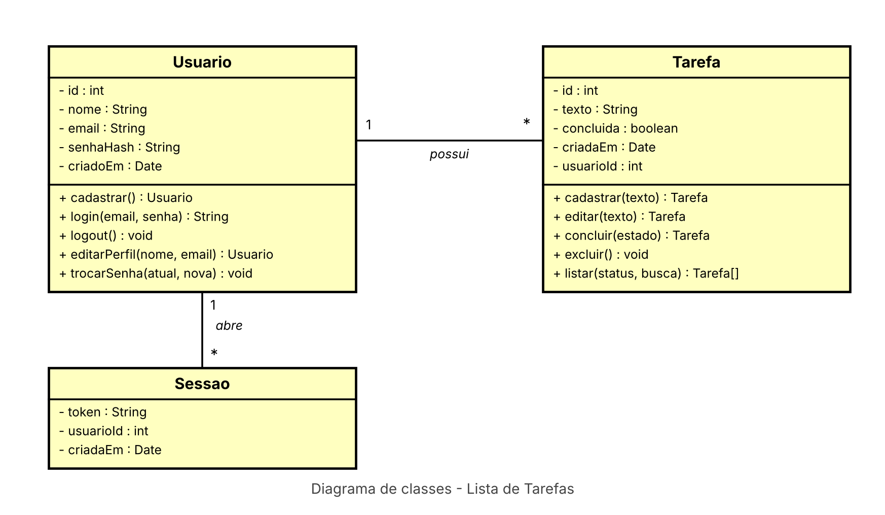
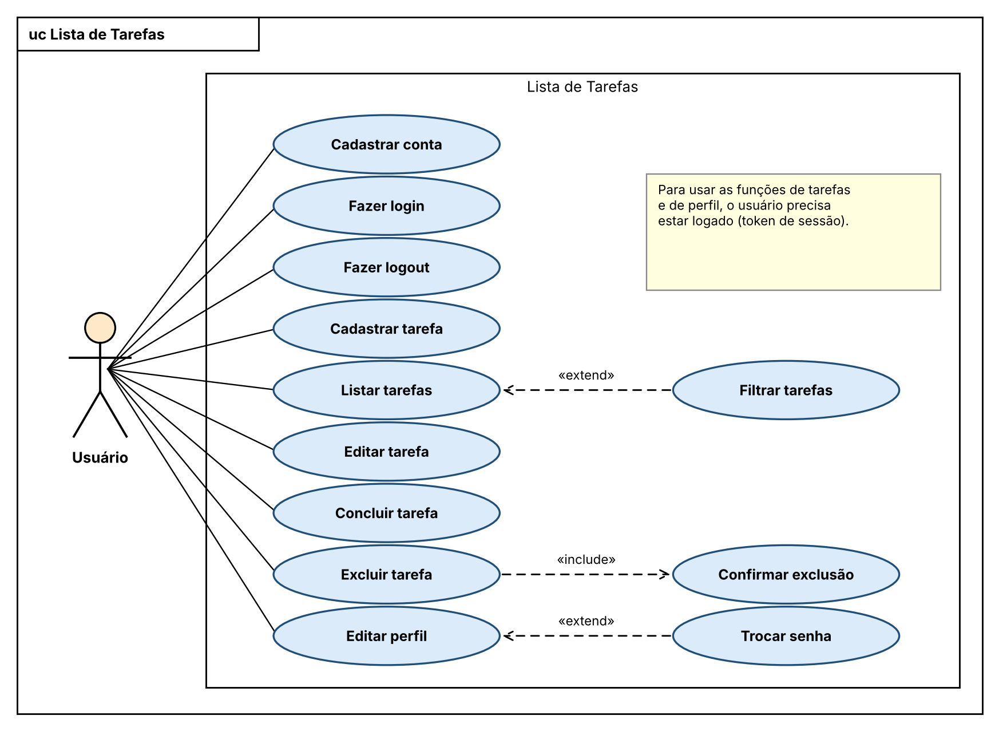

# Lista de Tarefas

Projeto de Software com front-end, back-end e banco de dados.

## Funcionalidades por entrega

- **AC1:** cadastrar uma tarefa (front-end + back-end + banco de dados)
- **AC2:** editar e concluir uma tarefa (front-end + back-end + banco de dados)
- **AC3:** excluir uma tarefa, cadastro e login de usuário (cada usuário vê só as suas tarefas) e filtros por texto e por status (front-end + back-end + banco de dados)
- **AC4:** editar o perfil (nome e e-mail) e trocar a senha (front-end + back-end + banco de dados), com diagrama de classes e diagrama de casos de uso

## Como rodar

### 1. Back-end
```
cd backend
npm install
npm start
```
O servidor sobe em `http://localhost:3000`. Um arquivo `tarefas.db` (SQLite) é criado automaticamente na primeira execução, e as colunas e tabelas novas (`concluida`, `usuario_id`, `usuarios` e `sessoes`) são adicionadas automaticamente caso ainda não existam.

### 2. Front-end
Abra a pasta `frontend` no VS Code e rode o **`login.html`** com a extensão Live Server.

1. Crie uma conta em **Cadastre-se** e entre com o e-mail e a senha.
2. Cadastre tarefas, use **Editar** para mudar o texto, o checkbox para concluir e **Excluir** para remover.
3. Use a busca e o filtro **Todas / Pendentes / Concluídas** para encontrar tarefas.
4. Em **Meu perfil**, edite o nome e o e-mail ou troque a senha.
5. Clique em **Sair** para encerrar a sessão.

Tudo fica salvo no banco de dados, não no navegador: atualize a página e os dados continuam lá.

## Estrutura
- `backend/server.js` - API com Express:
  - `POST /cadastro`, `POST /login` e `POST /logout` (usuários; a senha é salva criptografada)
  - `GET /perfil`, `PUT /perfil` e `PUT /perfil/senha` (perfil e troca de senha)
  - `GET /tarefas` (com filtros `?status=` e `?busca=`), `POST /tarefas`, `PUT /tarefas/:id` e `DELETE /tarefas/:id`
  - todas as rotas, exceto cadastro e login, exigem usuário logado
- `backend/tarefas.db` - banco SQLite (criado automaticamente)
- `frontend/login.html` e `login.js` - telas de login e cadastro de usuário
- `frontend/perfil.html` e `perfil.js` - tela de perfil e troca de senha
- `frontend/index.html`, `style.css` e `script.js` - lista de tarefas com cadastro, edição, conclusão, exclusão e filtros
- `docs/` - diagramas do sistema

## Diagramas

### Diagrama de classes


### Diagrama de casos de uso

